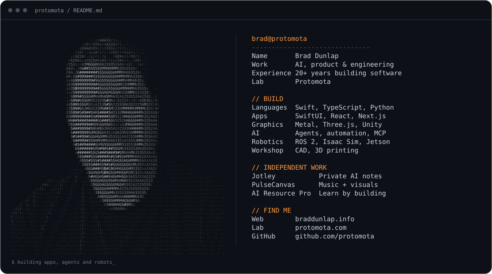

[Website](https://www.braddunlap.info) · [Protomota](https://protomota.com) · [LinkedIn](https://www.linkedin.com/in/bradley-dunlap/) · [YouTube](https://www.youtube.com/@protomota) · [Newsletter](https://newsletter.protomota.com)

I build software, automate the work around it, and make robots do things in the physical world.

- [Jotley](https://jotley.ai) — private AI notes for Mac, iPhone, and iPad.
- [PulseCanvas Studio](https://pulsecanvas.si) — music visualization and video creation.
- [AI Resource Pro](https://airesourcepro.com) — learn AI by building with it.
- [My personal site](https://github.com/protomota/braddunlap-info) — the code behind braddunlap.info, including the ASCII portrait generator.

The portrait, biography, and branded artwork remain the property of their respective owners.
